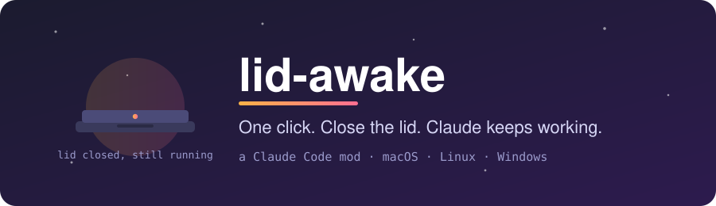
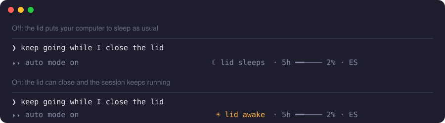
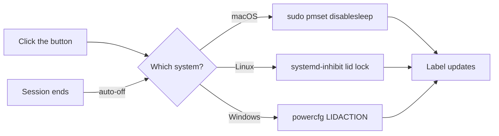

<p align="center">
  
</p>

<p align="center">
  <a href="https://github.com/apnauj/lid-awake/actions/workflows/ci.yml"></a>
  <a href="LICENSE"></a>
  
  
  
</p>

<p align="center">
  <b>A tiny footer button for Claude Code that keeps your computer awake with the lid closed.</b><br>
  Start a long session, click once, close the laptop, and walk away.
</p>

---

## Why

A long Claude Code session (a big refactor, a test loop, an overnight run) stops the moment your laptop goes to sleep. Closing the lid is the usual culprit.

`lid-awake` puts one small button next to your status items. Click it and the lid stops putting the machine to sleep. Click it again, or end the session, and everything goes back to normal.

## What it looks like

<p align="center">
  
</p>

| State | Button | Meaning |
| --- | --- | --- |
| Off | `☾ lid sleeps` | Closing the lid sleeps the computer, as usual |
| On | `☀ lid awake` | Closing the lid keeps everything running |

The button is plain and dim. It sits just left of your other status items, and it lights up when you hover over it.

## Install

Inside a Claude Code session:

```text
/plugin install lid-awake --marketplace apnauj/lid-awake
```

Answer `y` to add the marketplace, then pick a scope. User scope is the usual choice. The mod is active right away.

From a shell:

```bash
claude plugin install lid-awake --marketplace apnauj/lid-awake
```

### One-time setup on macOS

macOS needs admin rights to change the sleep setting, and a mod cannot type a password. Allow exactly these two commands without one:

```bash
echo "$USER ALL=(root) NOPASSWD: /usr/bin/pmset -a disablesleep 0, /usr/bin/pmset -a disablesleep 1" \
  | sudo tee /etc/sudoers.d/pmset-lid \
  && sudo chmod 440 /etc/sudoers.d/pmset-lid \
  && sudo visudo -cf /etc/sudoers.d/pmset-lid
```

This grants nothing else. Only those two `pmset` calls run without a password. Linux and Windows need no setup.

## How it works

One mod, one code path per system. It detects your system at startup and uses the native mechanism:

| System | Mechanism | Privileges |
| --- | --- | --- |
| macOS | `sudo -n pmset -a disablesleep 1 / 0` | The sudoers rule above |
| Linux (systemd) | A `systemd-inhibit --what=handle-lid-switch` lock held by a background child process | None |
| Windows | `powercfg` sets the lid-close action to "do nothing" and restores your previous action later | None |



A few details worth knowing:

- **Real state, not a guess.** At session start the mod reads the machine's actual setting, so the label is correct even if you changed it by hand.
- **Auto-off.** Ending the Claude Code session turns the mode off, so you never leave your laptop unable to sleep by accident.
- **Clear errors.** If something fails (for example the sudoers rule is missing on macOS), you get a toast with the reason and the label does not change.

## Tech

- **Claude Code mod API.** A hooks module in `hooks/register.tsx` with three hooks: `session.start`, `session.end` and a `ui.render` hook on the footer's `SessionMode` slot.
- **TypeScript and JSX.** The button is an element drawn through `$.ui.resolve`, so it renders on any surface that draws the footer.
- **Typed state.** The on/off value is an `atom`, declared in `types/index.d.ts` and checked by `claude plugin validate`.
- **No dependencies.** Only host commands (`pmset`, `systemd-inhibit`, `powercfg`) run through `$.process`.
- **Tested.** `hooks/register.test.tsx` runs under `claude plugin test`.

```text
lid-awake/
├── .claude-plugin/
│   ├── plugin.json         # manifest
│   └── marketplace.json    # makes this repo installable
├── hooks/
│   ├── hooks.json          # points at the module
│   ├── register.tsx        # the whole mod
│   └── register.test.tsx   # test
├── types/index.d.ts        # state contract
└── assets/                 # README images
```

## Troubleshooting

| Problem | Fix |
| --- | --- |
| macOS toast says it needs the sudoers rule | Run the one-time setup command above, then click the button again. |
| The button is not visible | The footer needs a terminal wide enough to draw it. Widen the window, then check `/plugin` that `lid-awake` is enabled. |
| The label says `lid awake` after a crash | The mode survived a hard kill. Click the button once to turn it off. |
| Linux: toast says `systemd-inhibit` could not hold the lid | You need systemd and a normal desktop session. Check with `systemd-inhibit --list`. |
| Windows: the lid still sleeps the PC | Some laptops override the lid action in firmware or OEM software. Check `powercfg /query SCHEME_CURRENT SUB_BUTTONS LIDACTION`. |

Still stuck? [Open an issue](https://github.com/apnauj/lid-awake/issues/new/choose) with your system and what the button shows.

## Roadmap

- [ ] Auto-off timer (turn the mode off after a set time)
- [ ] `/lid` slash command
- [ ] Linux without systemd
- [ ] Interactive trailer

Ideas are welcome. See [CONTRIBUTING](CONTRIBUTING.md).

## Good to know

- **Heat.** A closed laptop runs warm. Keep it ventilated, and not in a bag.
- **Hard kills.** If the session is force-killed, the mode may stay on. The button shows the real state at the next start, so click it to turn it off.
- **Windows.** The mod restores the lid action you had before. If it cannot tell, it falls back to "sleep".
- **Linux.** Needs systemd with logind and a normal desktop session. Systems without systemd are not supported.

## Develop

```bash
git clone https://github.com/apnauj/lid-awake
claude --plugin-dir ./lid-awake            # try it in a session
claude plugin validate ./lid-awake         # check manifest, module and types
claude plugin test ./lid-awake             # run the tests
```

## License

[MIT](LICENSE) © Juan Pablo Alzate
